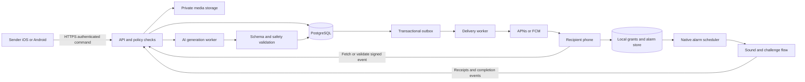

# Engineering blueprint

Status: proposed architecture, **18 October 2026**. Read the latest OS audit before writing native code. Choices below optimize for a small experienced team shipping a dependable social alarm product, with room to expand.

## 1. Architecture decision

**Default: SwiftUI iOS app + Kotlin/Jetpack Compose Android app + a TypeScript modular backend + PostgreSQL.** Share contracts, challenge schemas, policy fixtures and design tokens. Do not force platform lifecycle code into a common abstraction before it has been proven independently.

| Option | Benefits | Costs for Wake Me | Decision |
|---|---|---|---|
| Native SwiftUI + Compose | Direct access to new OS capabilities; native alarm/extension debugging; strong accessibility and interaction fidelity | Two UI implementations; requires macOS/Xcode for iOS | Recommended when both platforms and full capability depth matter |
| React Native + Expo development builds + native modules | Shared product UI and TypeScript skills; efficient small-team iteration | AlarmKit, Screen Time extensions and advanced Android lifecycle still need Swift/Kotlin; Expo Go is insufficient | Credible budget alternative after the native spikes pass |
| Flutter + native channels | Shared UI, consistent rendering | Same native capability burden plus Dart/bridge ownership | Choose if the team already has strong Flutter expertise |
| Kotlin Multiplatform domain layer | Shares deterministic business logic while preserving native UI | Extra build/debugging complexity; can slow initial delivery | Reconsider after the first two stable native vertical slices |
| PWA/WebView wrapper | Cheap distribution for invitations/admin | Does not provide the required native alarm/focus capabilities | Not the main app |

The native recommendation is contextual, not a claim that cross-platform apps cannot have excellent design. If budget forces one developer, prefer Android-first capability validation plus an iOS spike immediately, then make a documented codebase decision.

You currently have a Windows workspace. Android/backend development can happen here. iOS signing, simulator/device builds and extension debugging require a Mac or suitable macOS build host plus physical iPhones. A cloud build can produce a binary; it cannot replace bedside audio and lifecycle testing.

## 2. Proposed stack

| Layer | Choice | Operating notes |
|---|---|---|
| iOS UI | SwiftUI, current stable Swift/Xcode | Feature modules; `@Observable` state where appropriate; async/await; native accessibility |
| iOS persistence/network | SQLite through a maintained Swift wrapper, URLSession, Keychain | Keep alarm execution data available under an explicitly tested file-protection policy; secrets more restricted |
| iOS capabilities | AlarmKit, App Intents, WidgetKit/ActivityKit, AVFAudio; later FamilyControls/ManagedSettings/DeviceActivity and Core Location | Separate extension targets and entitlements; SDK availability checks |
| Android UI/domain | Kotlin, Compose, ViewModel, StateFlow, coroutines, Hilt | Unidirectional state and structured concurrency; platform lifecycle owners |
| Android persistence/network | Room, DataStore for preferences, OkHttp and generated/typed API client, Keystore | WorkManager for eventual synchronization, not precise alarm firing |
| Android capabilities | AlarmManager, notifications, permitted foreground services, audio focus and `USAGE_ALARM`; optional focus/location modules | API 37 background audio and activity restrictions explicitly tested |
| Backend | Current Node LTS, TypeScript strict mode, Fastify, JSON Schema validation | Modular monolith, separate API and worker processes; versions pinned during bootstrap |
| Database/auth | Managed PostgreSQL and Supabase Auth | Managed identity saves time; authorization remains Wake Me's responsibility |
| Jobs | PostgreSQL transactional outbox + leased worker jobs | Avoid an extra broker initially; add dedicated queue only when measured load justifies it |
| Media | Private object storage; Supabase Storage initially or R2 after cost/latency evaluation | No public buckets for voices or evidence; authenticated access or short-lived signed access |
| Push | Direct APNs for iOS, FCM HTTP v1 for Android | Distinct credentials per environment; no secrets in clients |
| Subscriptions | StoreKit / Google Play Billing through RevenueCat | Server-verified entitlements and webhook reconciliation |
| Operations | Structured logs, OpenTelemetry, error reporting with content scrubbing | Select one error/metrics vendor; do not duplicate trackers |
| AI | Server-only model adapter, structured outputs, budget limits | Opus 5.5 for development; runtime model chosen by evals and cost, not branding |
| Delivery | GitHub Actions, macOS build runner, Android CI, infrastructure as code | Protected production environment; signed artifacts and reproducible releases |

Offline-first local data and observable state follow the general pattern documented in [Android's offline-first guidance](https://developer.android.com/topic/architecture/data-layer/offline-first). Specific package versions are deliberately not guessed; Claude must check current stable releases and compatibility before locking them.

## 3. System diagram



The server orchestrates intent, permissions and synchronization. The recipient's OS is the execution environment. Neither an HTTP 200 nor an APNs/FCM acceptance is proof of audible playback.

## 4. Backend boundaries and repository

Start with modules: `identity`, `relationships`, `grants`, `commands`, `alarms`, `challenges`, `media`, `conversations`, `billing`, `safety`, `moderation`, `operations`. Each has an explicit interface and owns its tables. Use internal function calls and transactions, not premature network microservices.

Suggested future repository:

```text
apps/ios/
apps/android/
services/api/
services/worker/
packages/contracts/openapi.yaml
packages/challenges/schema/
packages/policy-fixtures/
packages/design-tokens/
infra/
docs/adr/
docs/threat-model/
docs/device-results/
docs/runbooks/
```

Native modules use domain/repository/platform boundaries. `AlarmScheduler`, `AudioRouteController`, `GrantStore`, `ChallengeRenderer`, `FocusController` and `LocationSession` are testable interfaces. Avoid a generic “phone control” service that can accept arbitrary commands.

## 5. Data model

Use opaque IDs, server timestamps, explicit versions and bounded retention. Foreign keys and unique indexes enforce invariants as well as code.

| Entity | Essential fields and constraints |
|---|---|
| `users` | auth subject, display name, locale, account state, age eligibility state; minimal identity data |
| `devices` | owner, platform/version/build, token reference, device public key, last seen, capability snapshot, primary alarm-device flag |
| `friendships` | canonical pair, pending/accepted/blocked state; unique pair; blocking takes precedence |
| `invites` | token hash, creator, expiry, max uses; one-time redemption; rate-limit attempts |
| `circles` / `circle_members` | private group, member role, join/leave state; group admin does not inherit members' phone permissions |
| `grants` | recipient/grantor, friend/grantee, capabilities, limits, validity, version, revoked timestamp |
| `alarm_plans` | owner, creator, target device, timezone policy, recurrence, sound/challenge references, version and lifecycle |
| `alarm_occurrences` | plan/version, occurrence ID, due instant, local installation receipt, result; unique plan occurrence |
| `commands` | actor, target, capability, grant version, payload hash, expiry, idempotency key, state |
| `command_events` | monotonically sequenced events, actor/device, server receipt time, client time, reason code |
| `challenge_definitions` | schema version, immutable published revision, creator, visibility, verifier type, bounds and digest |
| `challenge_sessions` | assigned revision, seed, started/completed/bypassed/expired state; evidence tier |
| `media_assets` | owner, object key, hash, type, bytes, duration, scan state, rights attestation, retention |
| `messages` | conversation, sender, body/media reference, moderation/report state, created time |
| `focus_policies` | user-owned local-selection handle, schedule, maximum duration, break/unlock policy |
| `location_sessions` | owner, authorized viewers, purpose, start/end, consent version |
| `location_samples` | session, captured/received timestamps, accuracy, encrypted coordinates, expiry |
| `entitlements` | account, product, provider, valid interval, latest verified event; unique provider event |
| `reports` / `audit_events` | minimal report evidence, review state, actor, reason, restricted access |
| `outbox` | event ID, command ID, due time, attempts, lease, processed timestamp; unique delivery key |

Separate schedule state from per-device installation state. If a friend edits an alarm but the recipient has not synchronized it, display both the proposed change and last confirmed installed time.

## 6. Consent and authorization model

Friendship is not permission. Permission is **directional**: A allowing B to wake A does not allow A to wake B.

Example grant, illustrative application contract rather than OS API:

```json
{
  "id": "grant_opaque",
  "grantorUserId": "recipient",
  "granteeUserId": "friend",
  "version": 7,
  "capabilities": ["nudge.send", "alarm.request", "challenge.assign"],
  "validUntil": "2026-11-18T00:00:00Z",
  "limits": {
    "maxNudgesPerHour": 3,
    "maxAlarmSeconds": 120,
    "allowedLocalWindows": [{"days": [1,2,3,4,5], "start": "06:30", "end": "09:30"}],
    "soundPolicy": "recipient_approved_library",
    "challengeTypes": ["quiz", "math", "chess"],
    "maxChallengeSeconds": 90
  }
}
```

Capabilities should remain small and comprehensible: `nudge.send`, `alarm.request`, `alarm.schedule`, `challenge.assign`, `focus.request`, `message.send`, `safety.checkin.request`, `location.last_known.read`. Location, loud alarms and focus cannot be implied by a basic nudge grant.

Enforce intersection of recipient grant, recipient global settings, platform permission, device capability and abuse limits. Apply per-sender, per-recipient and per-circle limits so five friends cannot multiply the intended alarm intensity by five.

Use recipient-local time windows, a clear timezone setting and documented overnight-window semantics. Quiet hours default on; the recipient can explicitly grant a wake window that overrides their ordinary quiet-hours policy inside Wake Me. The app's setting cannot promise control over unrelated system restrictions.

Revoke locally first: stop relevant audio, cancel friend-created pending local alarms, remove focus policies, invalidate grants and queue server sync. A server-side revocation cannot instantly change a disconnected device. Show “revoked here; other device pending sync” if relevant. A short sound already dispatched to the OS may be impossible to retract; disclose this race in engineering tests and cap its length.

Do not let recipients unknowingly preserve authority when a blocked user leaves/rejoins a group or changes accounts. Block must revoke related grants and invalidate invites atomically.

## 7. Command delivery and network behavior

### Immediate nudge

1. Sender chooses friend and approved sound; UI shows permitted actions.
2. Client sends POST with an idempotency key, intended capability and short expiry.
3. API checks identity, friendship, grant/version, allowed time, target capability, account standing and aggregate rate limits.
4. One database transaction stores the command, consumes rate quota and appends the outbox event.
5. Worker rechecks revocation/expiry before dispatch. APNs/FCM request uses appropriate short TTL. Do not retry a two-minute nudge hours later.
6. Recipient execution, when available, verifies the event, uses cached or fetched payload and emits available receipts.
7. Sender sees actual evidence: “Sent,” “Phone received,” “Opened,” or “No confirmation yet.”

For iOS OS-rendered notification sounds, the server may authorize and send a bundled sound without app code executing first. Local revalidation therefore cannot be claimed to gate every notification sound. Mitigate with short TTL, limited approved sounds, server dispatch checks and local OS notification settings. Higher-impact actions require app-side validation and native scheduling.

### Scheduled wake

Persist the plan, synchronize it, download assets and challenge revision, then install the native alarm. The recipient sends a receipt containing plan version, device ID, scheduled instant, asset hash and OS scheduler result. Only then show **Ready on Sam's phone**.

The alarm remains useful without the server at ring time. Quizzes, math and chess must run from the installed local challenge package. Cached plans survive app upgrades and ordinary process termination subject to documented platform behavior. Android reschedules after reboot/time changes through supported mechanisms. Test pre-first-unlock availability separately.

An edit is a new version. Prefer a replacement strategy that does not create a gap with no alarm; probe the actual OS API's atomicity. If replacement fails, report the exact retained/removed state. Never hide failure behind “Saved.”

### Scheduled follow-ups make challenge accountability stronger

Prototype an optional **recipient-approved wake sequence**: a main alarm at 07:00 and one follow-up at 07:03, both installed in advance. Completing the local challenge cancels the pending follow-up. Merely silencing the main system alarm does not mark the challenge complete. This gives the recipient a useful commitment mechanism without requiring a network call or uninterrupted app execution after the first alarm.

The recipient sees and approves the entire sequence, sound budget and challenge before enabling it. Keep the initial limit to one follow-up, allow an obvious in-app “End this wake session” that cancels every occurrence, and never silently replenish alarms after a user revokes/ends the routine. Test cancellation racing with a firing follow-up and restore pending state after a crash. Native scheduler limits and actual current-OS behavior are Stage 0 validation items. This is a proposed implementation, not a guarantee that an app can veto the OS Stop control.

### Delivery state is multidimensional

Track separately:

- Command: `accepted`, `rejected`, `expired`, `cancelled`.
- Transport: `queued`, `provider_accepted`, `provider_rejected`.
- Device: `unknown`, `received`, `installed`, `execution_reported`.
- Human outcome: `opened`, `acknowledged`, `challenge_completed`, `bypassed`.

Events can arrive late or out of order. Reduce them by version and precedence, not by “last event wins.” A challenge completion does not retroactively prove exact audio timing. A provider success does not become “ringing.”

### Transport rules

- HTTPS only; modern TLS, platform trust validation, no permissive certificate callbacks.
- Short request timeouts, exponential retry with jitter for safe/idempotent operations; honor `Retry-After`.
- Cursor-based synchronization backed by durable database records; foreground WebSocket/SSE is a convenience, not the source of truth.
- No always-open background WebSocket to keep a phone awake.
- Push payloads contain opaque IDs and minimal harmless display text. No location, quiz secrets or sensitive message body by default.
- Expiry applies at server dispatch and recipient execution. Use absolute UTC plus a bounded clock-skew policy; use monotonic clocks for running countdowns.
- Store recurrence as local wall time + IANA timezone + timezone policy, not a fixed UTC offset. Specify daylight-saving gap/fold behavior and travel behavior.
- Dedicated primary wake device by default; other devices get passive receipts. Multi-device simultaneous ringing is an explicit choice.
- Loss of service never blocks stopping an alarm or removing a local focus restriction.

## 8. API contract

Version the HTTP contract (`/v1`) and challenge data separately. Generate Swift/Kotlin clients from reviewed OpenAPI or maintain typed adapters with contract tests.

| Endpoint | Purpose | Key control |
|---|---|---|
| `POST /v1/devices` | Register this authenticated device | Bind owner; never accept arbitrary owner from request |
| `PATCH /v1/devices/{id}` | Token/capability refresh | Device ownership and reauthentication for sensitive changes |
| `POST /v1/invites` / `POST /v1/invites/redeem` | Pair friends | Hashed high-entropy tokens, expiry, enumeration protection |
| `POST /v1/friendships/{id}/block` | Block and revoke | Recipient/participant authority, atomic revocation |
| `PUT /v1/grants/{id}` | Create/update delegated permissions | Only grantor; `If-Match` version check |
| `DELETE /v1/grants/{id}` | Revoke | Idempotent; immediately disable new server actions |
| `POST /v1/commands` | Nudge/alarm/focus request | Capability-specific validated union, quota, idempotency |
| `GET /v1/commands/{id}` | Delivery evidence | Actor or recipient only |
| `POST /v1/commands/{id}/receipts` | Device event | Device-bound auth, allowed state and version |
| `POST /v1/alarm-plans` / `PATCH /v1/alarm-plans/{id}` | Schedule/update plan | Owner/grant checks; optimistic concurrency |
| `POST /v1/challenges/generations` | Queue AI authoring | Usage credits, schema version and prompt limits |
| `POST /v1/challenges/{id}/publish` | Freeze approved revision | Creator authority; validation and preview required |
| `POST /v1/challenge-sessions/{id}/events` | Completion/evidence | Assigned recipient only; classify evidence strength |
| `POST /v1/media/uploads` / `POST /v1/media/{id}/finalize` | Upload/scan assets | MIME/size/duration limits; ownership and scanning |
| `GET /v1/sync?cursor=...` | Recover all updates | User-scoped opaque cursor and bounded pages |
| `POST /v1/conversations/{id}/messages` | Private communication | Membership and block state checked per write |
| `POST /v1/location-sessions` | Recipient starts sharing | Explicit scope, viewers and expiry |
| `GET /v1/location-sessions/{id}/latest` | Authorized last location | Live grant check; audit access; no public link |
| `POST /v1/reports` | Abuse/content report | Evidence minimization and triage queue |
| `POST /v1/billing/webhooks/{provider}` | Entitlement changes | Provider authenticity, replay protection and reconciliation |
| `DELETE /v1/account` | Account deletion | Recent auth; immediate deactivation; deletion job |

Return structured errors: `code`, safe user message, retryability and request ID. Use 401 for missing/invalid auth, 403 for known denied capability where disclosure is appropriate, 404 to avoid leaking unrelated objects, 409 for versions, 422 for invalid content, 429 for quotas and 503 for unavailable service. Never leak relationship existence to strangers.

## 9. Authentication and sessions

Start with Sign in with Apple, Google and email link/OTP as supported by the selected provider. Do not make SMS mandatory: it adds cost, abuse exposure and excludes users without a number. Support guest personal alarms, then require an account for friends/cloud features.

Use authorization code with PKCE, `state`, `nonce`, verified universal/app links and strict redirect allowlists. Validate issuer/audience/expiry/signature server-side. Handle key rotation safely. Never trust a client-submitted email or social provider profile as authenticated identity.

Keep refresh tokens in Keychain/Keystore-backed storage; access tokens short-lived. Rotate and revoke sessions, list active devices, and require recent authentication for account recovery, new high-impact grants and recovery-factor changes. Use the provider's supported refresh-reuse protection where available.

Do not link two accounts merely because unverified email strings match. Require authenticated proof for both identities. Revoking a session also revokes its device's ability to submit receipts or issue commands. Removing a primary phone requires reassignment and alarm-readiness confirmation.

Passkeys are a desirable later addition if the identity stack supports them cleanly; do not build a custom WebAuthn server casually. Human support must not bypass identity checks using knowledge of friends' names or inside jokes.

## 10. Security threat model and controls

Use [OWASP MASVS](https://mas.owasp.org/) as the mobile verification baseline. It is a checklist and testing framework, not a certification automatically obtained by using a skill.

| Threat | Required control | Verification |
|---|---|---|
| Malicious friend repeatedly wakes someone | Recipient limits, per-recipient aggregation, quiet windows, easy block/revoke | Five senders cannot exceed recipient sound budget |
| Object-ID substitution | Authorization on every object query and mutation | A cannot read B/C conversations, grants, media or location |
| Grant escalation | Only recipient grants; schema limits; versions | Sender cannot change allowed intensity/time/challenge types |
| Revoked queued action | Recheck at dispatch and local execution where possible | Revoke races with queued/retried commands |
| Replay/duplicate delivery | Idempotency + command IDs + expiry + processed-ID store | Duplicate push produces at most one native occurrence |
| Forged device receipt | Device ownership and authenticated event submission | Third device cannot claim another's challenge completion |
| Token theft | Secure storage, short-lived access, session revocation | Logout and recovery invalidate expected access |
| Malicious upload/URL | Upload allowlists, transcoding isolation, no arbitrary server fetch | SSRF URLs, oversized/decompression bombs and malformed audio rejected |
| AI prompt injection | Input as data; no tools/secrets; schema validator; safe primitive allowlist | Prompt cannot create code, grant permissions or request location |
| Stalking/coercion | No stealth sharing; per-viewer location grants; visible active sessions; quick revoke | Blocked friend loses new access; session expires automatically |
| Admin compromise | MFA, least privilege, audited just-in-time access | No routine support access to location/messages |
| Billing spoof | Server verification, authenticated webhooks, replay-safe ledger | Fake/replayed purchase does not extend access |
| Supply-chain compromise | Pin dependencies/skills/actions; SBOM; secret/dependency scanning | CI cannot export secrets to unapproved build steps |

Database roles must be explicit. Supabase secret/service keys bypass RLS, so “RLS is enabled” does not secure an API that uses an unrestricted key for every query. Prefer scoped roles and tested policy functions, or enforce authorization in the API with RLS as defense in depth. Separate migration/admin credentials from runtime credentials. [Supabase data security](https://supabase.com/docs/guides/database/secure-data)

Encrypt traffic and managed storage; additionally encrypt sensitive location fields with managed keys and restricted decrypt access. Do not advertise end-to-end encryption unless a reviewed client-key protocol actually implements it. Initial private chat may be server-readable under a disclosed policy with audited access. Before scaling safety/location features, assess a maintained E2EE protocol rather than inventing cryptography.

Protect backups, device caches, notification previews and logs. Exclude tokens, coordinates, quiz answers, full prompts and message bodies from telemetry. Mask sensitive screens in app-switcher snapshots where needed; choose Android `FLAG_SECURE` for sensitive surfaces after evaluating accessibility/support tradeoffs. Root/jailbreak signals are risk hints, not an excuse to disable a user's local alarm at wake time.

Evaluate App Attest and Play Integrity for high-abuse endpoints as additional risk signals, with server verification, request binding/replay protection and a documented fallback. They supplement account/grant authorization; they do not prove a person is awake or make client receipts unforgeable. Bind device keys to an authenticated registration and rotate them on recovery. Revocation prevents future authorized location reads but cannot erase a screenshot or copy a previously authorized viewer already made; the consent screen must not promise retroactive deletion from another person's possession. [App Attest](https://developer.apple.com/documentation/devicecheck/establishing-your-app-s-integrity), [Play Integrity](https://developer.android.com/google/play/integrity/overview)

Pinning certificates is optional after a real threat review; if adopted, include backup pins and a rotation/recovery strategy. Broken pinning can prevent alarm synchronization. Platform validation without insecure overrides is the default.

## 11. AI challenge engine

The AI is a **challenge author**, not the runtime judge of every action. It generates a constrained `ChallengeDefinition` using existing native primitives. User instructions and private group context are untrusted data.

Pipeline: prompt → minimal context → input/content checks → structured generation → schema validation → semantic validation → safety policy → deterministic solver checks → preview/edit → recipient acceptance when required → immutable version → local download.

Initial primitives: multiple choice, exact/normalized short answer, math expression generated by safe code, memory ordering, chess from a verified position/solution set, timer, QR/barcode, and self-attested task. Later primitives: on-device pose counting and guitar note/chord practice. Every sensor primitive has a manual/accessible alternative.

```json
{
  "schemaVersion": 1,
  "title": "The flat's morning quiz",
  "kind": "sequence",
  "maxDurationSeconds": 90,
  "difficulty": "easy",
  "steps": [
    {
      "type": "multiple_choice",
      "prompt": "What do we call our Thursday dinner?",
      "options": ["Chaos curry", "Monday brunch", "Library lunch"],
      "correctIndex": 0,
      "source": "creator_provided"
    },
    {"type": "math", "operands": [7, 8], "operator": "+", "answer": 15}
  ],
  "verification": "local_deterministic",
  "fallback": {"type": "accessible_checkin"},
  "permissionsRequired": []
}
```

The schema is illustrative. The actual JSON Schema must bound nesting, string length, number of steps, options, duration, asset sizes and permitted transitions; reject unknown fields. Sign published payloads server-side to detect tampering, but do not mistake a signature for safe content.

Inside jokes require the creator to supply facts and correct answers. The model must not invent private memories. Treat school/organization names and people's private information as optional sensitive context, not default training material. Minimize provider retention according to the chosen contract and disclose what is sent.

Math correctness comes from deterministic calculation. Chess must use legal FEN positions, valid moves and a checked solution; AI-generated chess explanations alone are not a verifier. Review dataset and engine licenses before bundling; a GPL engine creates different distribution obligations than a permissively licensed move validator.

Guitar challenges begin with a timer/self-check or local pitch feedback. A microphone signal cannot prove genuine practice without error. Camera rep-counting can be spoofed and can fail for lighting, mobility or framing. Label evidence tiers: self-report, device-detected, friend-reviewed. Do not market them as fraud-proof.

Do not permit challenges involving rapid drinking/eating, dangerous exercise, holding breath, pain, substances, sexual humiliation, private credentials or financial transfers. A harmless-sounding prompt can become unsafe through quantity or time pressure. Validate both manual and AI-created challenges. Focus access and sound-stopping never depend on an unavailable friend or remote AI service.

“Any unique challenge” should be marketed as describing and combining supported activities, with an honest message when a requested sensor/interaction is unavailable. New executable primitives ship through reviewed app updates. [Apple software and creator-content rules](https://developer.apple.com/app-store/review/guidelines/)

## 12. Focus, messaging and safety modules

Focus policies are locally selected and finite. A friend can request a 25-minute session inside an accepted maximum, not choose arbitrary applications remotely or permanently lock the device. Keep emergency communication/system access available. Temporary unlock grants expire locally and do not depend on the server to restore the correct state. Recurring policies are preinstalled; live remote changes are pending until applied.

Use private 1:1/circle text and reactions initially. Add reporting, blocking, link handling and content moderation before public launch. No public discovery feed or anonymous inbox in the first release. Private groups still need abuse controls. Do not index their content for marketing or AI retrieval outside the group.

Safety MVP: recipient starts a check-in/share session, chooses viewers and expiry, can send SOS, and can explicitly share the latest known location. A missed habit or unsolved alarm does not automatically authorize precise location access. If a recipient preauthorizes a missed-check-in policy, display its trigger clearly and make cancellation easy. All viewers see capture time and accuracy; never present stale points as live tracking.

Retention proposals: overwrite latest location by default, expire safety sessions within user-chosen short periods, delete raw challenge evidence after 24 hours unless explicitly retained for a report, keep minimal command metadata for 30 days, and limit security audit records to a reviewed purpose/time. Final periods require legal/product review and consistent backup deletion. No indefinite “just in case” archive.

## 13. Reliability, testing and operations

Required test layers:

- Pure policy tests: grants, time windows, timezone changes, races, role boundaries.
- Shared golden fixtures: native/server decision parity and challenge verification.
- API/database integration: cross-user access, transaction/outbox atomicity, retries, migration rollback.
- Device automation: cold launch, permission denial, navigation, focus unlock and purchase restoration.
- Physical tests: silent/Focus/DND, screen off overnight, earbuds/wired/USB/CarPlay or equivalent, calls, low power, low volume, network loss, process kill, force-stop, reboot, storage pressure and OS updates.
- Fault injection: push duplication/reordering, stale grants, worker outage, corrupted audio, bad AI output, time skew, billing outage and account deletion during pending alarms.

Measure installed-alarm reliability and immediate-push latency separately. Instrumentation cannot always observe OS-owned audible output; use external audio/time capture in QA and honest evidence labels in production.

Targets for initial release: >99.9% crash-free sessions; API availability 99.9%; p95 command acceptance under 500 ms excluding login and poor client connectivity; zero known critical/high authorization vulnerabilities. These are goals, not current measurements. For alarm timing, publish the sample size, device mix, observed failures and tested conditions rather than claiming a universal percentage.

Before launch: backup restore drill; key rotation drill; noisy-friend incident drill; subscription reconciliation; deletion/export test; feature kill switches for remote dispatch, AI and location. Kill switches should stop new risky remote behavior while preserving personal local alarms and escape controls. Support staff need concise logs with request IDs, not private content.
